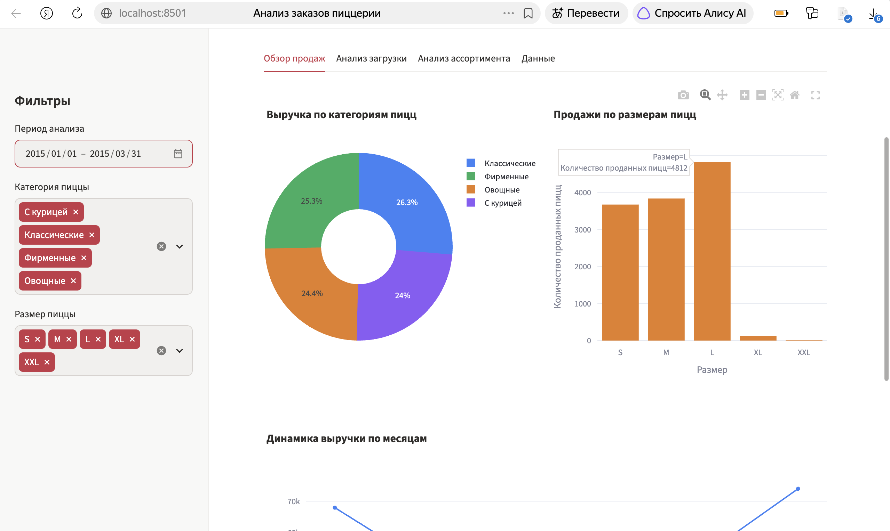
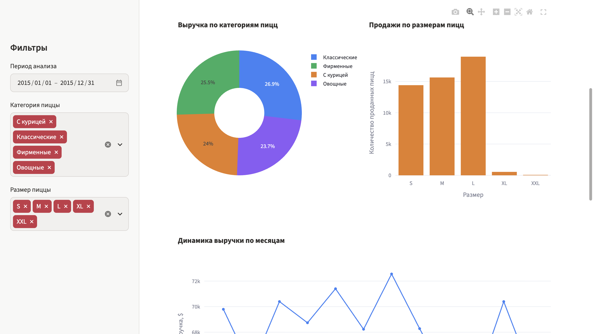
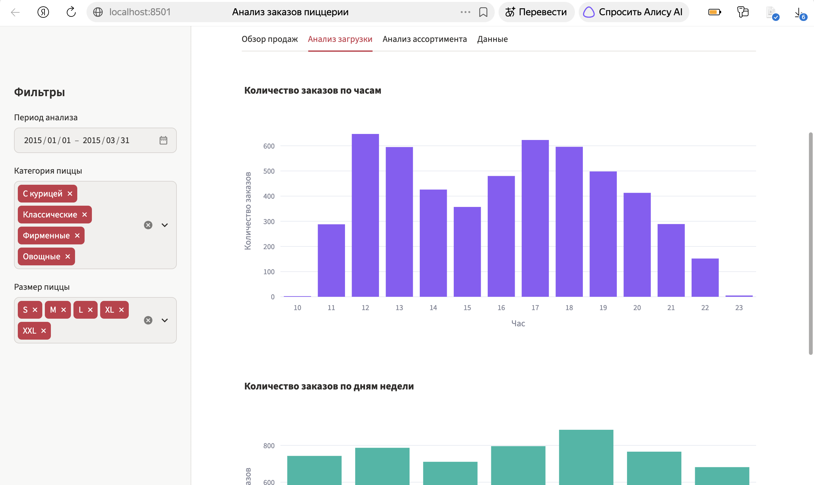
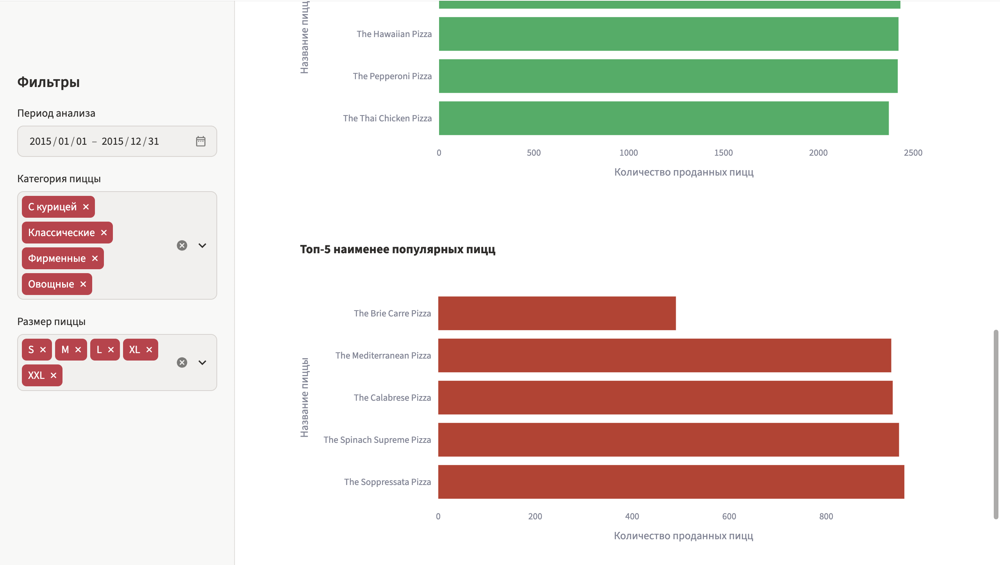

# 🍕 Анализ заказов пиццерии

**Pizza Analytics** — интерактивное веб-приложение для анализа заказов пиццерии, расчёта ключевых показателей продаж и визуализации данных.

Приложение позволяет анализировать выручку, количество заказов, загруженность пиццерии и популярность ассортимента. Все показатели и графики обновляются в зависимости от выбранных фильтров.

## Содержание

- [Цель и задачи проекта](#цель-и-задачи-проекта)

- [Функциональные возможности](#функциональные-возможности)

- [Используемые технологии](#используемые-технологии)

- [Исходные данные](#исходные-данные)

- [Структура проекта](#структура-проекта)

- [Установка и запуск](#установка-и-запуск)

- [Запуск через Docker](#запуск-через-docker)

- [Тестирование](#тестирование)

- [Интерфейс приложения](#интерфейс-приложения)

- [Результаты](#результаты)

- [Возможности дальнейшего развития](#возможности-дальнейшего-развития)

- [Команда проекта](#команда-проекта)

- [Источники](#источники)

## Цель и задачи проекта

**Цель проекта** — автоматизация анализа заказов пиццерии для получения информации о продажах, востребованности ассортимента и загруженности пиццерии.

Задачи проекта:

- Загрузка и обработка исходных данных из CSV-файлов.

- Расчёт ключевых показателей продаж.

- Анализ динамики выручки по месяцам и дням.

- Определение периодов наибольшей загрузки пиццерии.

- Анализ популярности ассортимента.

- Определение самого прибыльного дня недели.

- Разработка интерактивного пользовательского интерфейса.

- Реализация фильтрации и выгрузки данных.

- Проверка корректности аналитических функций с помощью автоматических тестов.

## Функциональные возможности

Приложение позволяет выполнять анализ заказов пиццерии по нескольким направлениям.

### Фильтрация данных

Пользователь может фильтровать данные по следующим параметрам:

- Период анализа.

- Категория пиццы.

- Размер пиццы.

Фильтры позволяют выбрать одну или несколько категорий и размеров пицц.

При изменении фильтров показатели, графики и таблица заказов пересчитываются для выбранных данных.

### Ключевые показатели

В приложении реализовано семь ключевых показателей:

| Показатель | Описание |
|---|---|
| Общая выручка | Суммарная стоимость проданных пицц |
| Количество заказов | Количество уникальных заказов |
| Продано пицц | Общее количество проданных пицц |
| Средний чек | Отношение общей выручки к количеству заказов |
| Средняя дневная выручка | Средняя выручка за календарный день выбранного периода |
| Среднее количество пицц в заказе | Отношение количества проданных пицц к количеству заказов |
| Самый прибыльный день недели | День недели с наибольшей суммарной выручкой |

Средняя дневная выручка рассчитывается с учётом всех календарных дней выбранного периода, включая дни без продаж.

Самый прибыльный день определяется по суммарной выручке за все соответствующие дни недели в выбранном периоде.

### Анализ продаж

Реализованы следующие графики:

- Выручка по категориям пицц.

- Продажи по размерам пицц.

- Динамика выручки по месяцам.

- Динамика выручки по дням.

Графики позволяют сравнивать продажи разных категорий и отслеживать изменение выручки во времени.

### Анализ загрузки

Приложение позволяет анализировать:

- Количество заказов по часам.

- Количество заказов по дням недели.

- Распределение заказов по дням недели и часам с помощью тепловой карты.

Тепловая карта помогает определить периоды наиболее высокой активности заказов.

### Анализ ассортимента

Приложение позволяет:

- Определить пять наиболее популярных пицц.

- Определить пять наименее популярных пицц.

- Проанализировать продажи по категориям пицц.

### Работа с данными

Пользователь может просматривать детализацию заказов и выгружать отфильтрованные данные в CSV-файл.

## Используемые технологии

| Технология | Назначение |
|---|---|
| Python 3.14 | Язык программирования |
| Pandas | Обработка и анализ данных |
| Streamlit | Разработка веб-интерфейса |
| Plotly | Построение интерактивных графиков |
| Pytest | Автоматическое тестирование |
| Git / GitHub | Контроль версий и командная разработка |
| Docker | Контейнеризация приложения |
| VS Code | Среда разработки |

## Исходные данные

В проекте используется открытый набор данных **Pizza Place Sales**.

Период данных: **с 01.01.2015 по 31.12.2015**.

Данные представлены четырьмя CSV-файлами.

| Файл | Описание | Количество записей |
|---|---|---:|
| orders.csv | Даты и время заказов | 21 350 |
| order_details.csv | Состав заказов и количество пицц | 48 620 |
| pizzas.csv | Размеры и стоимость пицц | 96 |
| pizza_types.csv | Названия, категории и ингредиенты | 32 |

### Пример входных данных

Пример записи из файла `order_details.csv`:

| order_details_id | order_id | pizza_id | quantity |
|---|---|---|---|
| 1 | 1 | hawaiian_m | 1 |

### Подготовка данных

Исходные таблицы объединяются по общим идентификаторам:

- `order_id` — идентификатор заказа.

- `pizza_id` — идентификатор варианта пиццы.

- `pizza_type_id` — идентификатор типа пиццы.

После объединения выполняется преобразование даты и времени заказа.

Дополнительно рассчитываются:

- `month` — номер месяца.

- `day_of_week` — номер дня недели.

- `hour` — час заказа.

- `revenue` — стоимость позиции заказа.

Стоимость позиции рассчитывается по формуле:

**Выручка позиции = Количество × Цена**

Для определения дня недели используется нумерация Pandas: от 0 (понедельник) до 6 (воскресенье).

### Пример выходных данных

После обработки формируется единый набор данных, содержащий сведения о заказах и стоимости каждой позиции.

| Номер заказа | Дата | Пицца | Размер | Количество | Стоимость, $ |
|---|---|---|---|---:|---:|
| 1 | 01.01.2015 | The Hawaiian Pizza | M | 1 | 13.25 |

## Структура проекта

```text

pizza_analytics/

├── .streamlit/

│   └── config.toml

├── data/

│   ├── orders.csv

│   ├── order_details.csv

│   ├── pizzas.csv

│   └── pizza_types.csv

├── screenshots/

│   ├── overview.png

│   ├── overview1.png

│   ├── workload.png

│   ├── workload1.png

│   ├── assortment.png

│   ├── assortment1.png

│   ├── data.png

│   └── tests.png

├── tests/

│   ├── test_analytics.py

│   └── test_data_loader.py

├── utils/

│   ├── __init__.py

│   ├── data_loader.py

│   ├── analytics.py

│   └── charts.py

├── app.py

├── requirements.txt

├── Dockerfile

├── .dockerignore

├── .gitignore

└── README.md

```

### Описание модулей

| Модуль | Назначение |
|---|---|
| app.py | Пользовательский интерфейс приложения |
| data_loader.py | Загрузка, объединение и подготовка данных |
| analytics.py | Фильтрация данных, расчёт показателей |
| charts.py | Построение интерактивных графиков |
| test_analytics.py | Тестирование аналитических функций |
| test_data_loader.py | Тестирование загрузки и подготовки данных |
| config.toml | Настройки интерфейса Streamlit |
| requirements.txt | Перечень зависимостей проекта |
| Dockerfile | Инструкция по сборке Docker-образа |

## Установка и запуск

### Требования

Для локального запуска приложения необходимы:

- Python.

- Git.

- Установленные зависимости из `requirements.txt`.

Для запуска через Docker дополнительно необходим Docker Desktop.

### Клонирование репозитория

```bash

git clone https://github.com/Arinayarkova13/pizza_analytics.git

cd pizza_analytics

```

### Создание виртуального окружения

Откройте терминал в корневой папке проекта и выполните:

```bash

python3 -m venv .venv

```

Активация виртуального окружения на macOS и Linux:

```bash

source .venv/bin/activate

```

Активация виртуального окружения на Windows (PowerShell):

```powershell

.venv\Scripts\Activate.ps1

```

### Установка зависимостей

```bash

python -m pip install -r requirements.txt

```

### Запуск приложения

```bash

python -m streamlit run app.py

```

После запуска приложение доступно по адресу:

http://localhost:8501

Для остановки приложения нажмите `Ctrl+C` в терминале.

## Запуск через Docker

### Сборка Docker-образа

```bash

docker build -t pizza-analytics .

```

### Запуск контейнера

```bash

docker run --rm -p 8501:8501 --name pizza-app pizza-analytics

```

После запуска приложение доступно по адресу:

http://localhost:8501

## Тестирование

Для проверки корректности работы приложения используется библиотека **pytest**.

В проекте реализовано **23 автоматических теста**.

| Тестовый модуль | Количество тестов | Назначение |
|---|---:|---|
| test_data_loader.py | 7 | Проверка загрузки и подготовки исходных данных |
| test_analytics.py | 16 | Проверка аналитических функций и расчётов |
| **Итого** | **23** | **Проверка основных функций приложения** |

### Проверка загрузки данных

Тестами проверяются:

- Загрузка исходных CSV-файлов.

- Количество строк после объединения.

- Наличие необходимых столбцов.

- Корректность типа данных даты.

- Расчёт стоимости позиций заказов.

- Отсутствие пропущенных значений.

- Обработка отсутствующих файлов.

### Проверка аналитических функций

Проверяются:

- Расчёт ключевых показателей продаж.

- Обработка пустых данных.

- Фильтрация данных.

- Обработка фильтров без результатов.

- Расчёт выручки по месяцам и дням.

- Распределение заказов по часам.

- Распределение заказов по дням недели.

- Распределение заказов по дням недели и часам.

- Определение наиболее и наименее популярных пицц.

- Анализ продаж по категориям.

- Анализ продаж по размерам пицц.

- Корректное определение дня недели с максимальной выручкой.

- Обработка пустого набора данных при определении самого прибыльного дня недели.

- Обработка ситуации, когда несколько дней имеют одинаковую максимальную выручку.

### Запуск всех тестов

```bash

python -m pytest -v

```

### Запуск тестов через Docker

```bash

docker run --rm pizza-analytics python -m pytest -v

```

### Результаты тестирования

Все 23 теста успешно пройдены.

Время выполнения может отличаться в зависимости от используемого компьютера.


## Интерфейс приложения

Приложение реализовано с использованием Streamlit.

Интерфейс включает боковую панель фильтров, ключевые показатели и четыре вкладки аналитики.

### Обзор продаж

Во вкладке «Обзор продаж» отображаются:

- Семь ключевых показателей.

- Выручка по категориям пицц.

- Продажи по размерам пицц.

- Динамика выручки по месяцам.

- Динамика выручки по дням.





### Анализ загрузки

Во вкладке «Анализ загрузки» представлены:

- Количество заказов по часам.

- Количество заказов по дням недели.

- Тепловая карта заказов по дням недели и часам.

Тепловая карта позволяет определить периоды наибольшего количества заказов.




### Анализ ассортимента

Во вкладке «Анализ ассортимента» отображаются:

- Пять наиболее популярных пицц.

- Пять наименее популярных пицц.

- Продажи по категориям пицц.




### Данные

Во вкладке «Данные» пользователь может:

- Просмотреть детализацию заказов.

- Изучить информацию по выбранным фильтрам.

- Скачать отфильтрованные данные в CSV-файл.


## Результаты

В результате разработки получено веб-приложение для анализа заказов пиццерии с интерактивными фильтрами, ключевыми показателями и графиками.

Приложение позволяет:

- Автоматизировать расчёт показателей продаж.

- Анализировать изменение выручки во времени.

- Определять наиболее загруженные периоды.

- Выявлять популярные и непопулярные пиццы.

- Сравнивать продажи по категориям и размерам.

- Получать детализацию данных для дальнейшего анализа.

## Возможности дальнейшего развития

В дальнейшем приложение можно расширить следующими возможностями:

- Подключение базы данных вместо статических CSV-файлов.

- Загрузка новых данных через интерфейс.

- Сравнение показателей за разные периоды.

- Прогнозирование спроса.

- Расширение аналитических отчётов.

## Команда проекта

- Яркова Арина.

- Афанасьев Леонид.

- Лебедева Вероника.

- Ралко Пётр.

## Источники

- [Pizza Place Sales — Maven Analytics](https://mavenanalytics.io/data-playground/pizza-place-sales)

- [Документация Python](https://docs.python.org/3/)

- [Документация Pandas](https://pandas.pydata.org/docs/)

- [Документация Streamlit](https://docs.streamlit.io/)

- [Документация Plotly](https://plotly.com/python/)

- [Документация Pytest](https://docs.pytest.org/)

- [Документация Docker](https://docs.docker.com/)
