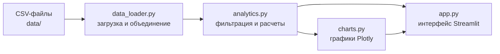
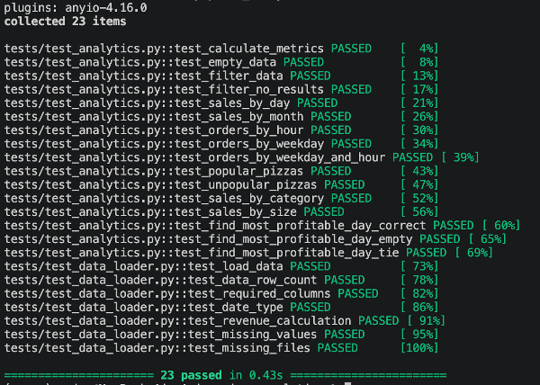
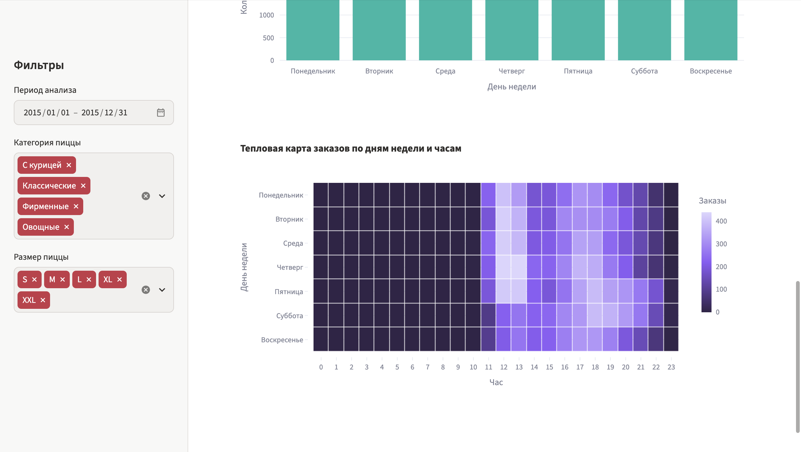
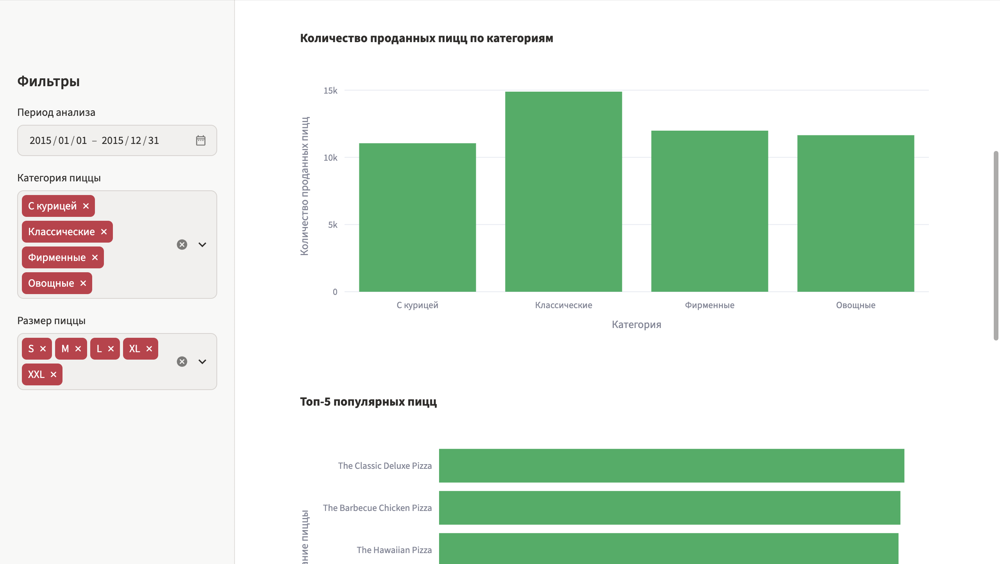
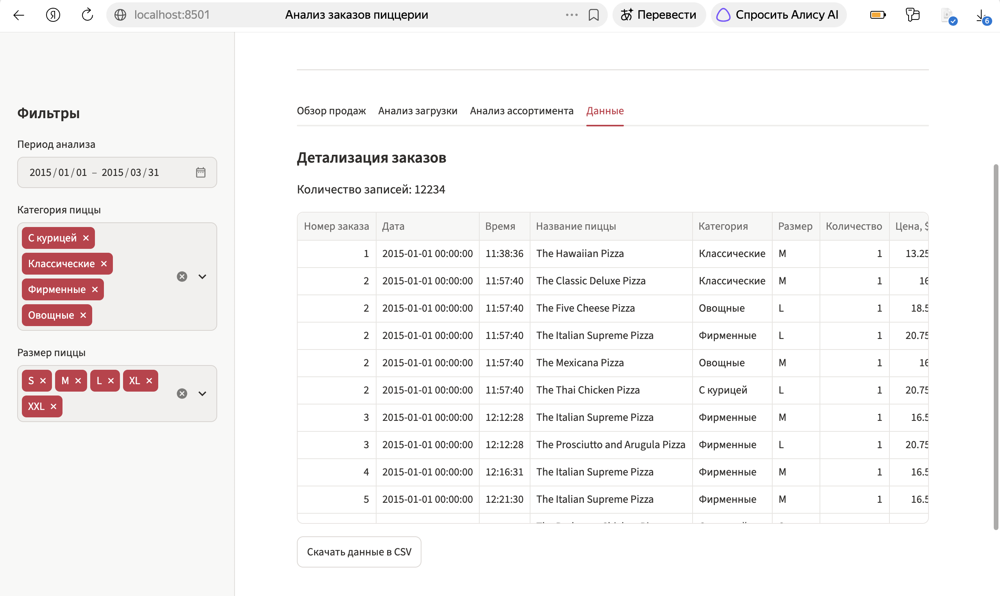

# Анализ заказов пиццерии

Pizza Analytics - прикладное цифровое решение для анализа заказов
пиццерии. Приложение загружает исходные CSV-файлы, объединяет их в единый набор данных,
рассчитывает ключевые показатели продаж и показывает результаты на интерактивных
графиках с фильтрами по периоду, категории и размеру пиццы.

## Содержание

## Содержание
- [Цель и задачи проекта](#цель-и-задачи-проекта)
- [Функциональные возможности](#функциональные-возможности)
- [Используемые технологии](#используемые-технологии)
- [Исходные данные](#исходные-данные)
- [Архитектура и обработка данных](#архитектура-и-обработка-данных)
- [Структура проекта](#структура-проекта)
- [Установка и запуск](#установка-и-запуск)
- [Запуск через Docker](#запуск-через-docker)
- [Тестирование](#тестирование)
- [Интерфейс приложения](#интерфейс-приложения)
- [Результаты](#результаты)
- [Возможности дальнейшего развития](#возможности-дальнейшего-развития)
- [Команда проекта](#команда-проекта)
- [Источники](#источники)

## Цель и задачи проекта

**Цель** — автоматизировать анализ заказов пиццерии, чтобы получать информацию
о продажах, востребованности ассортимента и загрузке заведения.

Задачи проекта:

1. Загрузить и подготовить исходные данные.
2. Рассчитать ключевые показатели продаж.
3. Проанализировать динамику выручки.
4. Определить периоды наибольшей загрузки пиццерии.
5. Проанализировать популярность ассортимента.
6. Разработать интерактивный пользовательский интерфейс.
7. Проверить корректность аналитических функций автотестами.

## Функциональные возможности

**Фильтры (боковая панель):**

- период анализа (диапазон дат);
- категория пиццы, с пунктом «Выбрать все»;
- размер пиццы (S, M, L, XL, XXL), с пунктом «Выбрать все».

**Ключевые показатели:**

| Показатель | Как рассчитывается |
|---|---|
| Общая выручка | Сумма `количество × цена` по всем позициям |
| Количество заказов | Число уникальных номеров заказов |
| Продано пицц | Сумма количества по всем позициям |
| Средний чек | Выручка / количество заказов |
| Средняя дневная выручка | Выручка / число календарных дней периода (дни без продаж учитываются как 0) |
| Среднее количество пицц в заказе | Продано пицц / количество заказов |

**Вкладки дашборда:**

| Вкладка | Графики и данные |
|---|---|
| Обзор продаж | Выручка по категориям (кольцевая диаграмма), продажи по размерам, динамика выручки по месяцам и по дням |
| Анализ загрузки | Заказы по часам, заказы по дням недели, тепловая карта «день недели × час» |
| Анализ ассортимента | Продажи по категориям, топ-5 самых популярных и топ-5 наименее популярных пицц |
| Данные | Таблица заказов с учетом фильтров и выгрузка в CSV |

Дополнительно:

- графики интерактивные (масштабирование, подсказки, сохранение в PNG средствами Plotly);
- категории, месяцы и дни недели переведены на русский язык;
- CSV-файл выгружается в кодировке UTF-8 с BOM и корректно открывается в Excel;
- если по выбранным фильтрам нет данных или период выбран не полностью, приложение показывает подсказку и не падает.

## Используемые технологии

| Технология | Версия | Назначение |
|---|---|---|
| Python | 3.14 | Язык программирования |
| Pandas | 3.1.1 | Обработка и анализ данных |
| Streamlit | 1.67.0 | Веб-интерфейс |
| Plotly | 7.1.0 | Интерактивные графики |
| Pytest | 9.2.0 | Модульное тестирование |
| Docker | — | Контейнеризация приложения |
| Git / GitHub | — | Контроль версий и хранение кода |
| VS Code | — | Среда разработки |

## Исходные данные

В проекте используется открытый набор данных Pizza Place Sales (Maven Analytics).
Период данных: с 01.01.2015 по 31.12.2015.

Данные представлены четырьмя CSV-файлами:

| Файл | Описание | Количество записей |
|---|---|---:|
| orders.csv | Даты и время заказов | 21 350 |
| order_details.csv | Состав заказов и количество пицц | 48 620 |
| pizzas.csv | Размеры и стоимость пицц | 96 |
| pizza_types.csv | Названия, категории и ингредиенты | 32 |

### Пример входных данных

Пример записи из файлов:

`order_details.csv`:

| order_details_id | order_id | pizza_id | quantity |
|---:|---:|---|---:|
| 1 | 1 | hawaiian_m | 1 |

`orders.csv`:

| order_id | date | time |
|---:|---|---|
| 1 | 2015-01-01 | 11:38:36 |

### Пример выходных данных

После объединения и обработки исходных таблиц формируется единый
набор данных, содержащий информацию о заказах и стоимости их позиций.

| Номер заказа | Пицц в заказе | Дата | Время | Название пиццы | Категория | Размер | Количество | Цена, $ | Стоимость позиции, $ |
|---:|---:|---|---|---|---|---|---:|---:|---:|
| 1 | 1 | 01.01.2015 | 11:38:36 | The Hawaiian Pizza | Классические | M | 1 | 13.25 | 13.25 |

## Архитектура и обработка данных


Подготовка данных (`utils/data_loader.py`):

1. Чтение четырех CSV-файлов (`pizza_types.csv` в кодировке `latin1`).
2. Объединение таблиц: `order_details` → `orders` (по `order_id`) → `pizzas` (по `pizza_id`) → `pizza_types` (по `pizza_type_id`).
3. Преобразование даты в `datetime`, выделение часа, месяца и дня недели.
4. Расчет стоимости позиции: `revenue = quantity × price`.

Подготовленные данные кешируются через `st.cache_data`, поэтому при смене
фильтров CSV-файлы заново не читаются.

### Структура проекта

```text
pizza_analytics/
├── .streamlit/
│   └── config.toml          # настройки интерфейса Streamlit
├── data/                    # исходные данные
│   ├── orders.csv
│   ├── order_details.csv
│   ├── pizzas.csv
│   └── pizza_types.csv
├── screenshots/             # скриншоты для README
├── tests/                   # автотесты
│   ├── test_analytics.py
│   └── test_data_loader.py
├── utils/                   # бизнес-логика
│   ├── __init__.py
│   ├── data_loader.py
│   ├── analytics.py
│   └── charts.py
├── app.py                   # точка входа, интерфейс
├── requirements.txt
├── Dockerfile
├── .dockerignore
├── .gitignore
└── README.md
```

### Описание модулей

| Модуль | Назначение | Основные функции |
|---|---|---|
| `app.py` | Интерфейс: фильтры, метрики, вкладки, выгрузка CSV | — |
| `utils/data_loader.py` | Загрузка, объединение и подготовка данных | `load_data`, `prepare_data`, `get_data` |
| `utils/analytics.py` | Фильтрация и расчет показателей | `filter_data`, `calculate_metrics`, `sales_by_day`, `sales_by_month`, `orders_by_hour`, `orders_by_weekday`, `orders_by_weekday_and_hour`, `popular_pizzas`, `unpopular_pizzas`, `sales_by_category`, `pizzas_by_category`, `sales_by_size` |
| `utils/charts.py` | Построение графиков, словари перевода | `monthly_sales_chart`, `daily_sales_chart`, `hourly_orders_chart`, `weekday_orders_chart`, `orders_heatmap`, `popular_pizzas_chart`, `unpopular_pizzas_chart`, `category_sales_chart`, `category_pizzas_chart`, `size_sales_chart` |
| `tests/test_analytics.py` | Тесты аналитических функций | 13 тестов |
| `tests/test_data_loader.py` | Тесты загрузки и подготовки данных | 7 тестов |
| `.streamlit/config.toml` | Настройки интерфейса Streamlit | — |
| `requirements.txt` | Зависимости с зафиксированными версиями | — |
| `Dockerfile` | Сборка Docker-образа | — |

## Установка и запуск

### Требования

- Python 3.14.
- Git.
- Docker Desktop.

### 1. Клонирование репозитория

```bash
git clone <ссылка-на-репозиторий>
cd pizza_analytics
```

### 2. Создание виртуального окружения

Откройте терминал в корневой папке проекта и выполните:

```bash
python3 -m venv .venv
```

macOS / Linux:

```bash
source .venv/bin/activate
```

Windows:

```bash
.venv\Scripts\activate
```

### 3. Установка зависимостей

```bash
python -m pip install -r requirements.txt
```

### 4. Запуск приложения

```bash
python -m streamlit run app.py
```

Приложение откроется по адресу **http://localhost:8501**.
Чтобы остановить его, нажмите `Ctrl+C` в терминале.

> Модуль загрузки данных можно проверить отдельно:
> `python -m utils.data_loader` выведет число строк, заказов, проданных пицц и общую выручку.

## Запуск через Docker

Сборка образа:

```bash
docker build -t pizza-analytics .
```

Запуск контейнера:

```bash
docker run --rm -p 8501:8501 --name pizza-app pizza-analytics
```

Приложение будет доступно по адресу **http://localhost:8501**.

Образ собирается на основе `python:3.14-slim`. Streamlit запускается на
`0.0.0.0:8501`, поэтому приложение доступно с хост-машины.

## Тестирование

Тесты написаны на **pytest**. Всего **18 автотестов**:

| Файл | Кол-во | Что проверяется |
|---|---:|---|
| `test_data_loader.py` | 7 | Загрузка четырех таблиц; число строк после объединения (48 620); наличие нужных столбцов; тип даты; расчет стоимости позиции; отсутствие пропусков; ошибка `FileNotFoundError` при отсутствии файлов |
| `test_analytics.py` | 11 | Расчет метрик (в том числе средней дневной выручки и пицц в заказе); метрики на пустых данных; фильтрация, в том числе с пустым результатом; выручка по дням с заполнением дней без продаж; выручка по месяцам; заказы по часам, дням недели и их сочетаниям; топ популярных и непопулярных пицц; выручка по категориям; продажи по размерам |

Аналитические функции проверяются на небольшом синтетическом наборе данных
(фикстура `sample_data`), загрузка — на реальных CSV-файлах.

Локальный запуск:

```bash
python -m pytest -v
```

Запуск внутри Docker:

```bash
docker run --rm pizza-analytics python -m pytest -v

### Результаты тестирования

Все 18 тестов успешно пройдены.
Время выполнения при локальной проверке — 0,79 секунды.



## Интерфейс приложения

### Обзор продаж

Отображение ключевых показателей, выручки по категориям,
продаж по размерам и динамики выручки по месяцам.


### Анализ загрузки

Отображение количества заказов по часам и дням недели.




### Анализ ассортимента

Отображение пяти наиболее и наименее популярных пицц.




### Детализация заказов

Просмотр отфильтрованных данных и скачивание CSV-файла.



## Результаты

В ходе работы разработано веб-приложение для анализа заказов пиццерии
с интерактивными фильтрами и графиками.

### Ключевые показатели за 2015 год

| Показатель | Значение |
|---|---:|
| Общая выручка | 817 860,05 $ |
| Количество заказов | 21 350 |
| Продано пицц | 49 574 |
| Средний чек | 38,31 $ |
| Средняя дневная выручка | 2 240,71 $ |
| Среднее количество пицц в заказе | 2,32 |

Приложение позволяет автоматизировать расчет показателей
и упростить анализ продаж для руководства пиццерии.

### Основные выводы

- **Выручка стабильна в течение года**: от 64 тыс. $ (октябрь) до 72,6 тыс. $ (июль). Ярко выраженной сезонности нет.
- **Пиковые часы — обед и ранний вечер**: больше всего заказов в 12:00–13:00, второй пик — в 17:00–18:00.
- **Самый загруженный день — пятница**, самый спокойный — воскресенье.
- **Категории приносят примерно равную выручку**: классические — 26,9 %, фирменные — 25,5 %, с курицей — 24,0 %, овощные — 23,7 %.
- **Чаще всего покупают размер L** (38,2 % проданных пицц). На XL и XXL вместе приходится меньше 1,2 %.
- **Самые популярные пиццы**: The Classic Deluxe, The Barbecue Chicken, The Hawaiian (2 422).
- **Самая непопулярная пицца — The Brie Carre**. Ее стоит пересмотреть в первую очередь.

## Возможности дальнейшего развития

- Подключить БД вместо CSV-файлов.
- Загружать новые данные через интерфейс приложения.
- Сравнивать показатели за разные периоды.
- Прогнозировать спрос.
- Анализировать ингредиенты и популярные сочетания пицц в заказе.
- Развернуть приложение в облаке.

## Команда проекта

- Яркова Арина.
- Афанасьев Леонид
- Лебедева Вероника
- Ралко Петр

## Источники

- [Pizza Place Sales — Maven Analytics](https://mavenanalytics.io/data-playground/pizza-place-sales)
- [Документация Python](https://docs.python.org/3/)
- [Документация Pandas](https://pandas.pydata.org/docs/)
- [Документация Streamlit](https://docs.streamlit.io/)
- [Документация Plotly](https://plotly.com/python/)
- [Документация Pytest](https://docs.pytest.org/)
- [Документация Docker](https://docs.docker.com/)
